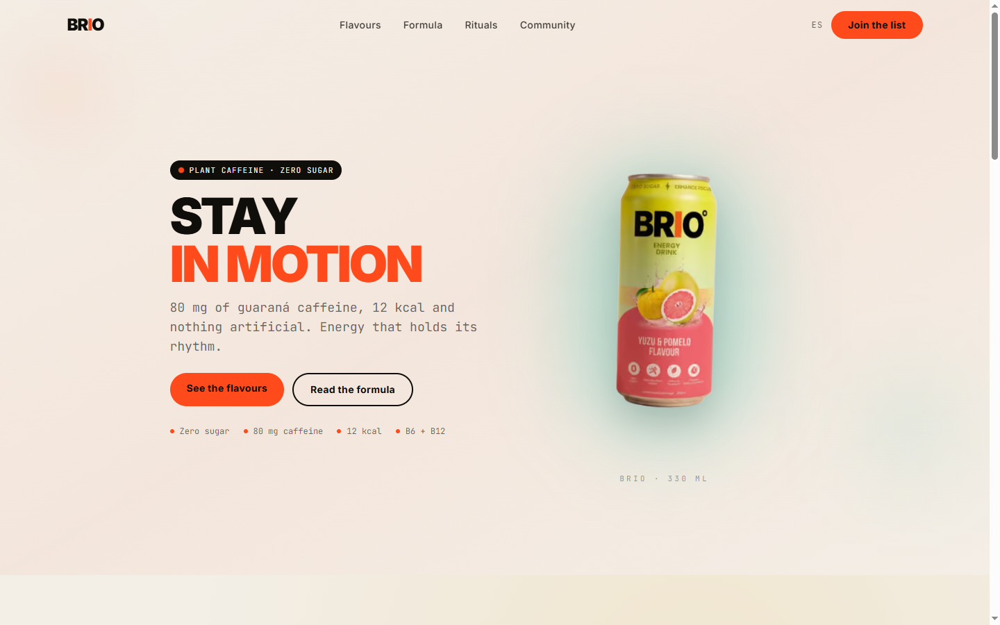

# Brio

A bilingual product site for a fictional zero-sugar energy drink, built with Next.js 16, TypeScript and Tailwind CSS v4.



## What it is

A single-page brand site with three parts that behave like a real product launch: a scroll-linked hero, a flavour selector that swaps the can and the accent colour, and a formula section with the nutritional spec.

It is a demo. There is no cart, checkout, payment or stock database, and the newsletter form is client-side only. Every product, testimonial and stockist is invented for this build.

## Why this over an energy-drink template

- **Two locales from the first route.** `/en` and `/es` are generated at build time, `proxy.ts` reads `Accept-Language`, and the header switch stores the choice in a cookie.
- **No copy in components.** Every string lives in `i18n/dictionaries`, typed by `en.ts`; a missing Spanish key fails `tsc`.
- **Four brand tokens.** `--ink`, `--bone`, `--signal` and `--jade` are declared once in `app/globals.css`; flavour accents are data in `content/brio.ts`.
- **Three assets, all local.** The cans were generated for this build with a blank label and no text, so the wordmark is always CSS and never baked into an image.
- **Six runtime dependencies.** Next, React, React DOM, framer-motion, lucide-react and Vercel Analytics. No UI kit, no carousel library, no smooth-scroll plugin.
- **No dead links.** Navigation and footer resolve to real section anchors or `mailto:` addresses.

## Quick start

Requirements: Node 24 and pnpm 11.

```bash
git clone <repo-url> brio-energy
cd brio-energy
pnpm install
pnpm dev
```

Open <http://localhost:3000>, or <http://localhost:3000/es> for Spanish.

| Command | What it does |
| --- | --- |
| `pnpm dev` | Start the development server |
| `pnpm build` | Create an optimized production build |
| `pnpm start` | Serve the production build |
| `pnpm typecheck` | Run `tsc --noEmit` |

## Internationalisation

`i18n/config.ts` holds the locale list and the cookie name. `i18n/dictionaries/en.ts` is the source of truth and exports the `Dictionary` type; `es.ts` is annotated with it, so a missing or renamed key is a type error.

`proxy.ts` redirects `/` and any unknown path to the preferred locale, in this order: the `NEXT_LOCALE` cookie, then `Accept-Language`, then `en`. `app/[locale]/layout.tsx` sets `<html lang>`, per-locale metadata and hreflang alternates.

## Content and design

`content/brio.ts` is the only place that holds media and brand values: the three cans in `public/images/cans` with their accent colours, plus the four palette values mirrored for inline styles. Copy lives in the dictionaries; nothing is duplicated between the two.

The flavour selector (`components/flavour-carousel.tsx`) swaps the can, the accent and the radial background through `AnimatePresence`. The formula cards (`components/formula-section.tsx`) use a spring-based pointer tilt. Both respect the reduced-motion preference at the CSS level for scroll behaviour.

## Project structure

```text
app/
  [locale]/
    layout.tsx        html lang, fonts, metadata, hreflang
    page.tsx          section composition
  globals.css         theme tokens and keyframes
  icon.svg            favicon
components/
  navigation.tsx      sticky header, locale switch
  hero-section.tsx    scroll-linked hero
  flavour-carousel.tsx
  formula-section.tsx
  rituals-section.tsx
  community-section.tsx
  site-footer.tsx     newsletter and footer
content/brio.ts       brand values, flavours
i18n/
  config.ts
  dictionaries/{en,es}.ts
  index.ts
proxy.ts              locale detection
```

## Deployment

The build is static apart from the locale redirect. On Vercel, import the repo and set one environment variable in Production and Preview:

```bash
NEXT_PUBLIC_SITE_URL=https://your-domain.example
```

It drives `metadataBase`, canonical URLs and Open Graph. The same value can be set locally in `.env.local`; `.env.example` has the placeholder.

Live demo: pending deployment.

## Status and scope

Verified: `pnpm build` (static generation of `/en` and `/es`), `pnpm typecheck`, and a visual pass at 390 px and 1440 px in both locales.

Out of scope: commerce, accounts, a CMS, email delivery and analytics beyond page views. The three cans are AI-generated for this build; no stock photography is used.

## License

Proprietary, all rights reserved. See [LICENSE](LICENSE).
